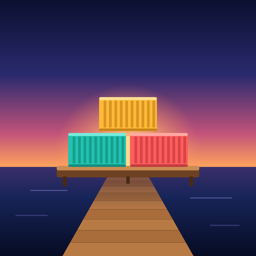
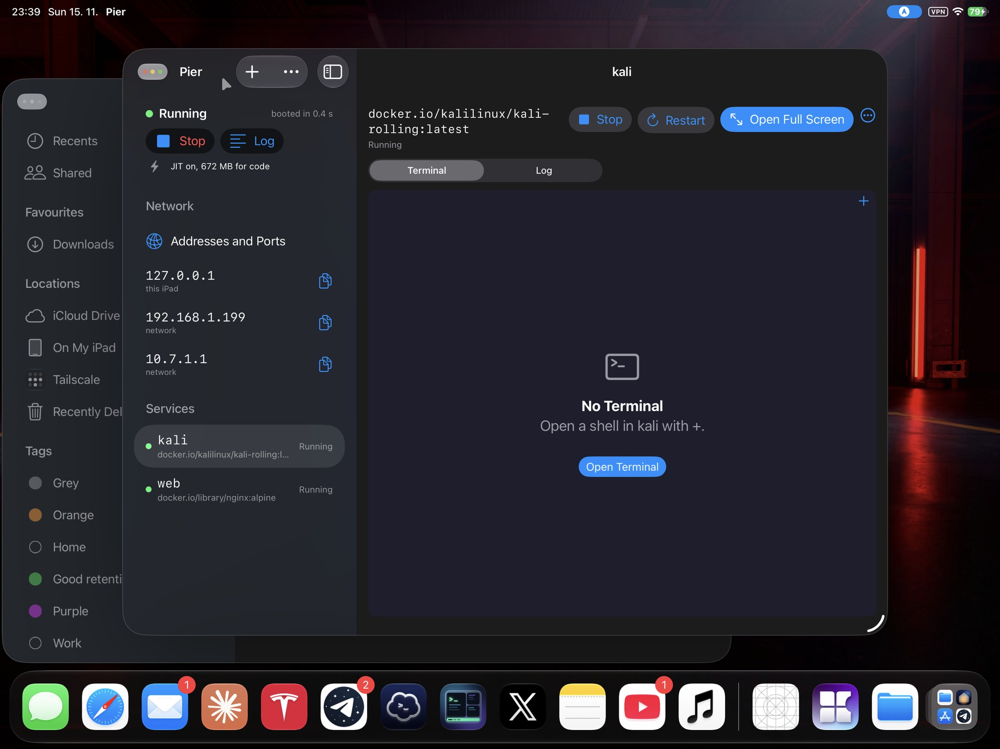
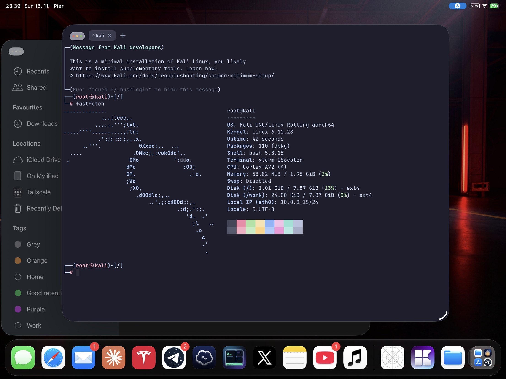
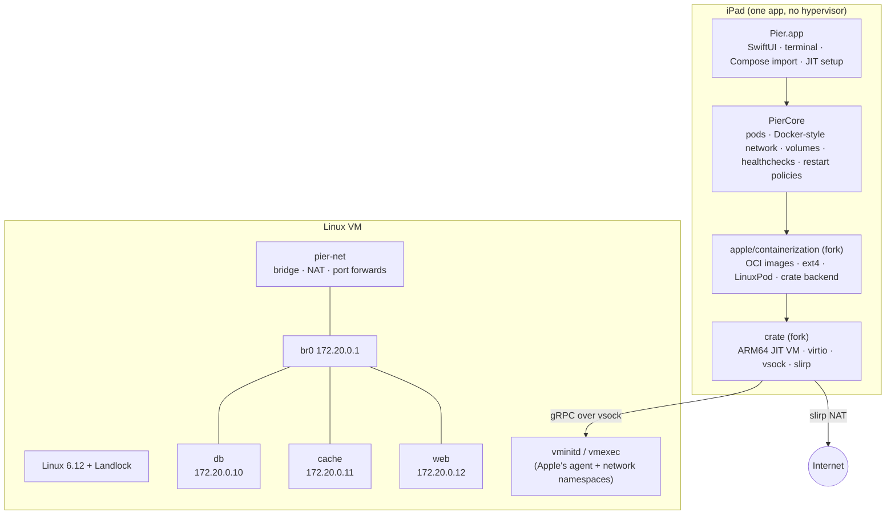

<p align="center">
  
</p>

<h1 align="center">Pier</h1>

<p align="center">
  <b>Docker-style pods on the iPad.</b><br>
  Linux containers from Docker Hub, side by side in one VM, with their own addresses,<br>
  a real terminal and Docker Compose. No jailbreak, no hypervisor.
</p>

<p align="center">
  
  
</p>

Pier runs [Apple's containerization](https://github.com/apple/containerization) (the library
behind Apple's `container` tool) on the iPad. The iPad has no hypervisor for apps, so the
virtual machine runs on [crate](https://github.com/oneamendez/crate), an ARM64-to-ARM64 JIT,
instead of Virtualization.framework. On a Mac the same code uses Hypervisor.framework.

## What it does

- **Pods of services.** Postgres, Redis, nginx, Kali, Alpine, anything with a `linux/arm64`
  image, in one VM. Pulled with Docker-style progress, unpacked into ext4 disks with a journal.
- **A network like Docker's.** Every service gets its own address (`172.20.0.x`) and host
  name, so two services can both listen on port 80. Ports are forwarded to the iPad, and
  optionally to your network.
- **Docker Compose.** Drop a `compose.yaml`, or the folder it lives in, onto Pier. It reads
  `image`, `command`, `entrypoint`, `environment`, `env_file` and `.env` (with `${VAR:-default}`),
  `ports`, named and bind `volumes`, `depends_on` with healthchecks, `restart`, `user`,
  `working_dir`, `privileged`, aliases, memory limits, profiles, anchors and `<<` merges.
  Whatever it can't do, it says.
- **One service at a time.** Stop, start or restart a service while the rest keep running.
  A service you stopped stays stopped the next time the pod starts.
- **A real terminal.** A shell straight into the container (a PTY over vsock, no SSH), with
  tabs and a full-screen mode. One button installs OpenSSH and tmux if you'd rather use
  an SSH client.
- **Keeps running.** Pods keep going in the background (coarse location keep-alive, on by
  default, never stored or sent).
- **Package managers that work.** apt, zypper and others are moved to HTTPS with a current CA
  bundle, since plain HTTP is often intercepted on mobile networks.
- **Storage.** See what images and disks take, and remove what nothing uses.

## Try it: the shop demo

[`examples/shop-demo`](examples/shop-demo) is a small shop that never sleeps:

| Service | What it is |
|---|---|
| `db` | Postgres with 400 fake customers, 24 products and 6,000 orders |
| `cache` | Redis with live counters, top products and an order feed |
| `shop` | makes an order every 0.3–2 s, into both |
| `monitor` | a live dashboard at <http://127.0.0.1:8088> |
| `shell` | `psql` and `redis-cli` ready; type `status` (or `status -w`) |

Copy the folder to the iPad (Files, AirDrop) and drop it on Pier, or use **+ › Import Docker
Compose**.

## How it works



### What comes from where

| Layer | Upstream | What Pier adds |
|---|---|---|
| VM engine | [crate](https://github.com/oneamendez/crate) (MPL-2.0): ARM64 JIT on iPad, HVF on Mac, virtio, slirp | a **virtio-vsock** device and its C API; two JIT fixes for exclusive loads and stores — [fork](https://github.com/Awis13/crate/tree/containers) |
| Containers | [apple/containerization](https://github.com/apple/containerization) (Apache-2.0): OCI images, ext4, `LinuxPod`, the `vminitd` agent | a **crate backend** in place of Virtualization.framework; builds for iOS; restart one container, per-container network namespaces, volume preparation — [fork](https://github.com/Awis13/containerization/tree/crate) |
| Guest | Kata's arm64 kernel config, Apple's `vminit` image | Landlock in the kernel; Pier's `vminitd`/`vmexec` laid over Apple's |
| Pods | — | `PierCore`: services, Docker-style bridge network, Compose, volumes, healthchecks, restart policies, storage |
| App | terminal on [SwiftTerm](https://github.com/migueldeicaza/SwiftTerm); JIT from [crate-ios](https://github.com/oneamendez/crate-ios) and StikJIT | everything you see |

A few details worth knowing:

- **Networking.** The VM has one NIC behind slirp. Pier starts a small helper container,
  `pier-net`, in the VM's own namespaces. It builds a bridge, gives each service a veth pair in
  its own network namespace, masquerades their traffic out and sends forwarded ports on to the
  right service. Apple's agent never joined a container's network namespace, so Pier ships its
  own `vmexec` that does.
- **Terminal.** A PTY process started through the agent, its stdio carried over vsock: no SSH
  server needed in the image.
- **Volumes.** Everything persistent lives in one shared ext4 volume mounted at `/work`. Named
  Compose volumes are directories under `/work/.pier/volumes`. Files next to a Compose file are
  copied into Pier and written to `/work/.pier/projects` each time the pod starts.

## Requirements

- An iPad with Apple silicon on iPadOS 26 or later. A Mac with Apple silicon for `pierctl`.
- JIT. Pier turns it on itself with a built-in StikJIT helper: it needs
  the LocalDevVPN app running and the iPad's
  pairing file in **On My iPad › Pier › StikJIT › pairingFile.plist** (see StikJIT's docs on
  making one).
- Images for `linux/arm64`.

## Building

Pier builds from three repositories side by side:

```sh
mkdir pier-src && cd pier-src
git clone https://github.com/Awis13/pier
git clone -b crate https://github.com/Awis13/containerization
git clone -b containers https://github.com/Awis13/crate crate-engine
git clone https://github.com/oneamendez/crate-ios
```

Then:

```sh
cd pier
guest/build.sh                  # the guest kernel and agent, in a Linux container (Docker,
                                # or CONTAINER_CLI=container); takes a while the first time
ios/Scripts/fetch-frameworks.sh ../crate-ios    # Slirp, GLib, StikJIT, crate, fonts, kernel
cd ios && xcodegen generate && open Pier.xcodeproj
```

Set your team in `ios/project.yml` (`DEVELOPMENT_TEAM`, bundle IDs) before building to a device.
You need Xcode 26 or later, [XcodeGen](https://github.com/yonaskolb/XcodeGen) and a Rust
toolchain from rustup (for crate).

### On a Mac: `pierctl`

The same pods from the command line, with Hypervisor.framework:

```sh
swift build --product pierctl
codesign -f -s - --entitlements pierctl.entitlements .build/debug/pierctl
.build/debug/pierctl -k ios/Resources/vmlinux --root ~/pier-data examples/shop-demo
```

`pierctl --check <compose folder>` only prints what a Compose file becomes. Tests:
`swift test`.

## Not yet

- **Building images.** Dropping a Dockerfile, or `build:` in Compose, isn't supported yet.
  Use an image from a registry.
- Adding or removing a service restarts the pod (crate can't attach disks to a running VM).
  Stopping and starting existing services doesn't.
- Forwarded ports are TCP only.
- Bind mounts are copies taken at import, not live folders.

## Licence

Pier is licensed under the [Mozilla Public License 2.0](LICENSE). It builds on crate and
crate-ios (MPL-2.0), apple/containerization (Apache-2.0), SwiftTerm (MIT), Yams (MIT), the
Mozilla CA bundle (MPL-2.0) and Nerd Fonts (each font under its own licence, kept in
`ios/Resources/Fonts/licenses`). See [NOTICE.md](NOTICE.md).
